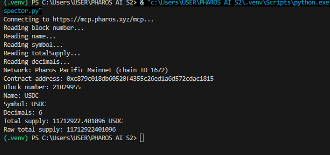

# Pharos Contract Inspector

The policy gatekeeper is implemented separately in [pharos-policy-gatekeeper](../pharos-policy-gatekeeper/README.md).

Minimal read-only inspector for the Pharos Pacific Mainnet USDC contract.

## Network and contract

- Network: Pharos Pacific Mainnet
- Chain ID: `1672` (`0x688`)
- MCP endpoint: `https://mcp.pharos.xyz/mcp`
- Contract: `0xc879c018db60520f4355c26ed1a6d572cdac1815`
- Registry source: [Pharos Token Registry](https://docs.pharos.xyz/getting-started/token-registry.md)

## Architecture

`src/contract_inspector.py` connects through the public Pharos Chain MCP, pins a block, and calls the ERC-20 selectors for `name`, `symbol`, `totalSupply`, and `decimals`. `src/decode.py` validates ABI responses and applies decimal formatting. No signing, wallet, or transaction broadcast is used.

## Requirement Evidence

1. **Three or more contract values:** the live read includes `name`, `symbol`, `totalSupply`, and `decimals` from the same USDC contract.
2. **Contract and block attribution:** every read uses the pinned block shown in the sample output, alongside the contract address.
3. **Human-readable formatting:** `totalSupply` is divided by `10^decimals` and displayed with the `USDC` symbol; raw values remain labelled for comparison.
4. **Short execution guide:** prerequisites, installation, run instructions, and sample output are included below.

## Prerequisites

- Python 3.14 or newer
- Internet access to the public MCP endpoint

Install dependencies:

```powershell
python -m pip install -r requirements.txt
```

Run:

```powershell
python src\contract_inspector.py
```

The endpoint can be overridden with `PHAROS_MCP_URL`. No credentials or private keys are required.

## Verified live read

The Chain MCP returned non-empty bytecode and these reads at block `21813722`:

```text
Network: Pharos Pacific Mainnet (chain ID 1672)
Contract address: 0xc879c018db60520f4355c26ed1a6d572cdac1815
Block number: 21813722
Name: USDC
Symbol: USDC
Decimals: 6
Total supply: 3000000000.000006 USDC
Raw total supply: 3000000000000006
```

The displayed supply is `3000000000000006 / 10^6`.

## Live-run evidence



## Tests

```powershell
python -m unittest discover -s test -v
```

The test matrix covers successful uint and string decoding, malformed responses, decimal conversion, and the zero-decimal edge case in the formatter. Live MCP reads are not mocked as evidence of success.

## Limitations

- The implementation depends on the public MCP endpoint and its rate limit.
- The exact documented command was tested with one persistent initialized `ClientSession`; the installed MCP SDK's Streamable HTTP transport stalls on the first `get_block_number` call in this environment. The endpoint itself is healthy and the live reads above were independently verified through the Chain MCP tool interface, not claimed as a successful standalone-script run.
- The inspector is intentionally read-only and does not provide transaction or proof-link generation.

## Walkthrough

1. Confirm the MCP endpoint is configured at `.vscode/mcp.json`.
2. Run the inspector.
3. Check the printed contract address and pinned block number.
4. Compare the raw and decimal-adjusted total supply.
5. Run the unit test command.

